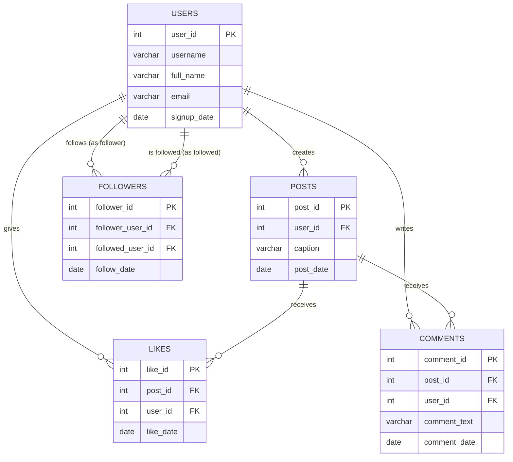

# Instagram Analytics — SQL Portfolio Project

A relational database and business-analytics SQL project modeling a simplified
social-media platform (users, posts, likes, comments, and a follower graph),
built to demonstrate end-to-end SQL skills: relational schema design, data
generation, and analytical querying — from basic filtering through window
functions, CTEs, and reusable views.

## Business context

Imagine you're a data analyst at a growing social app. Leadership wants to
know: who are our most valuable users, which content performs best, how fast
is the user base growing, and who are our real influencers? This project
answers exactly those questions using SQL alone.

## Entity-Relationship Diagram



## Dataset

| Table | Rows | Description |
|---|---|---|
| `users` | 100 | Account holders: username, full name, email, signup date |
| `posts` | 400 | Photo/content posts, linked to the user who made them |
| `likes` | 1,500 | Who liked which post, and when |
| `comments` | 600 | Who commented on which post, the text, and when |
| `followers` | 250 | The follow graph — who follows whom |

All data is synthetic (randomly generated with realistic names, dates spread
across an 18-month window, and no duplicate like/follow pairs), so it's safe
to publish publicly while still producing meaningful patterns for analysis.

## Project structure

```
instagram-analytics-sql/
├── schema.sql     # Creates the database and all 5 tables, with indexes
├── bulk_data.sql  # Loads the full sample dataset (100 users, 400 posts, etc.)
├── queries.sql    # 7 business-analysis queries + 1 reusable view
└── README.md
```

## Skills demonstrated

- Relational schema design (primary keys, foreign keys, indexes)
- Multi-table `JOIN`s (`INNER`, `LEFT`)
- Aggregation (`GROUP BY`, `HAVING`, `COUNT`, `SUM`, `ROUND`)
- Correlated subqueries
- Common Table Expressions (`WITH`)
- Window functions: `SUM() OVER`, `RANK() OVER (PARTITION BY ...)`, `LAG() OVER`
- A classic "Top-N per group" analytical pattern
- Reusable views (`CREATE VIEW`) as a lightweight reporting layer

## Key business questions answered

1. **Who are our most engaged users?** — ranks users by total likes and
   comments received across all their posts.
2. **Who creates the strongest content, pound-for-pound?** — average
   likes-per-post, a fairer measure than raw totals for users who post
   more or less frequently.
3. **How is our user base growing month over month?** — a running total of
   signups using a window function, the same logic behind a standard
   growth chart.
4. **What are our best-performing posts overall?** — combined likes +
   comments, revealing which content themes resonate most.
5. **Who are our real influencers?** — compares follower count to following
   count per user to separate genuine influence from active networking.
6. **What is each user's single best post?** — a "Top-N per group" query
   using `RANK() OVER (PARTITION BY user_id ...)`, a pattern frequently
   asked in SQL interviews.
7. **What's our month-over-month growth rate (%)?** — uses `LAG()` to
   compare each month to the previous one, the standard formula behind any
   "MoM growth" metric reported to stakeholders.
8. **A reusable view** (`post_engagement_summary`) packages query #4's logic
   permanently, so it can be queried directly without rewriting the joins —
   mirroring how real reporting layers are built on top of raw data.

## How to run this project (Windows + MySQL Workbench)

1. Install **MySQL Server** and **MySQL Workbench**
   ([dev.mysql.com/downloads/installer](https://dev.mysql.com/downloads/installer/)).
2. Open Workbench, connect to your local server (`localhost`), and open
   `schema.sql` via **File → Open SQL Script**. Run the whole script
   (the yellow lightning bolt icon) — this creates the database and tables.
3. Open `bulk_data.sql` the same way and run it — this loads all sample data.
4. Open `queries.sql` and run the queries one at a time (highlight each
   block, then **Ctrl + Enter**) to see each business question answered.

## Notes

- `signup_date`, `post_date`, `like_date`, etc. span January 2023 through
  October 2026, so growth and trend queries produce realistic patterns
  rather than a single flat snapshot.
- All string data is properly escaped for SQL safety (e.g. captions
  containing apostrophes).
